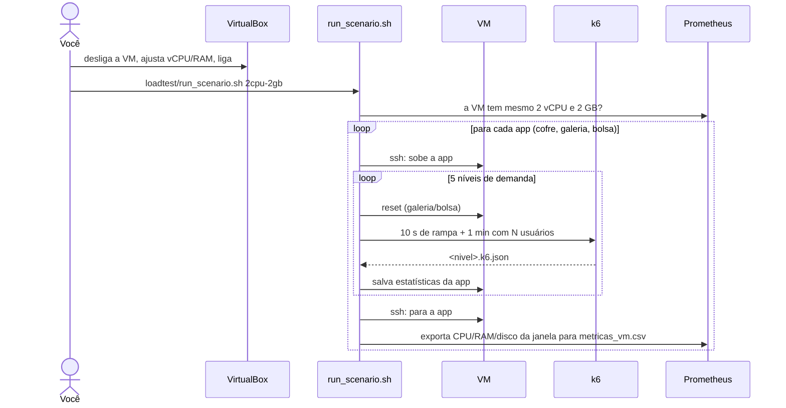
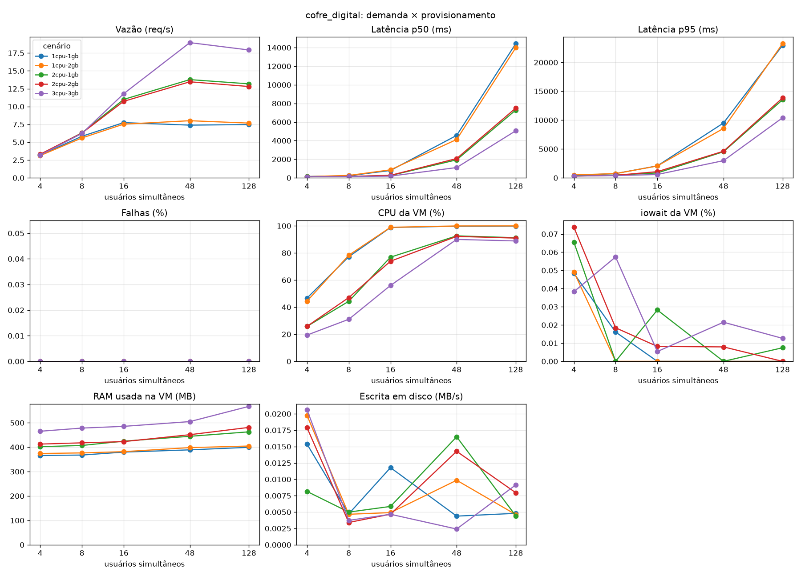
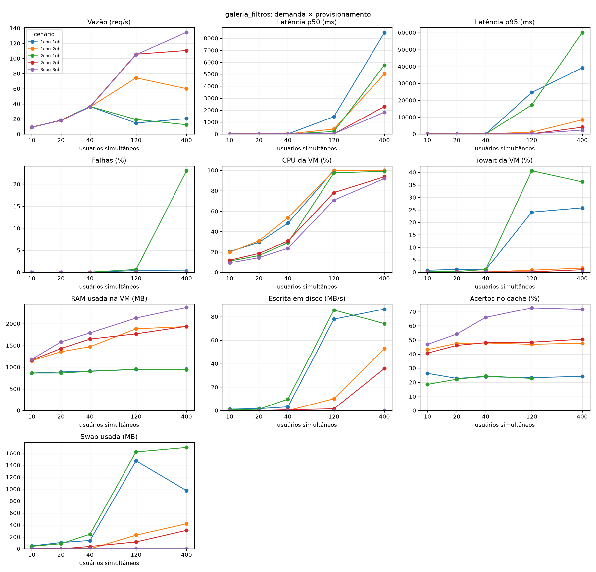
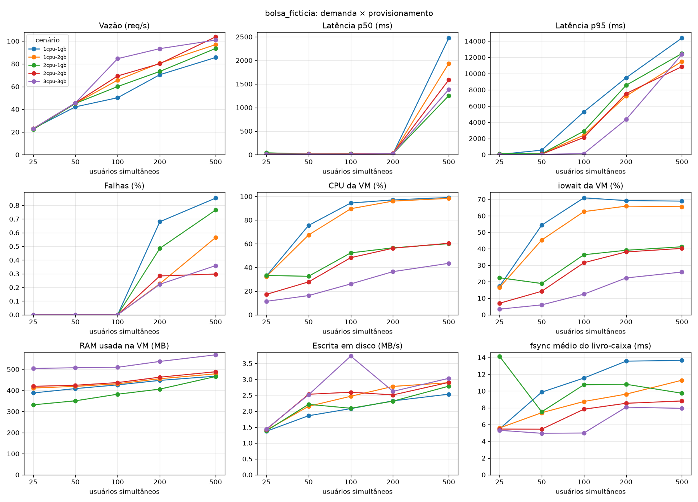

# Demanda, provisionamento e desempenho

Atividade 2 da disciplina Provisionamento e Operações de Infraestrutura.

Fizemos três aplicações backend, cada uma limitada por um recurso diferente (CPU, memória e disco). Elas rodam numa VM do VirtualBox e são testadas sob carga. Em cada experimento mudamos duas coisas: a demanda, que é quantos usuários simultâneos o k6 simula, e o provisionamento, que é quantas vCPUs e quanta RAM a VM tem.

Queríamos saber em que ponto o desempenho começa a cair e se dar mais recurso para a VM resolve. A resposta muda de app para app, porque cada uma esbarra num recurso diferente.

## As três aplicações

| App | Porta | Gargalo | O que faz |
|---|---|---|---|
| [Cofre Digital](apps/cofre_digital/README.md) | 8001 | CPU | Primos por divisão, SHA-256 iterado e multiplicação de matrizes, tudo em Python puro |
| [Galeria de Filtros](apps/galeria_filtros/README.md) | 8002 | memória | Gera imagens, guarda num cache LRU em RAM, aplica filtros e monta mosaicos |
| [Bolsa Fictícia](apps/bolsa_ficticia/README.md) | 8003 | disco | Corretora simulada: cada ordem é gravada no SQLite e num livro-caixa, com `fsync` |

Cada gargalo foi pensado de propósito. O cofre não usa numpy, então fica preso ao GIL e cada worker usa no máximo um núcleo. Por isso ele sobe um worker por vCPU (`WORKERS=auto`). A galeria reserva para o cache 40% da RAM da VM, e a carga do k6 usa 128 imagens diferentes (cerca de 1,7 GB), que não cabem no cache em nenhum cenário. A bolsa grava com `synchronous=FULL` e faz `fsync` a cada ordem.

As três seguem o mesmo padrão: FastAPI + Gunicorn, em camadas controller, service e repository.

## Como o experimento funciona


A carga sai do notebook. Se o k6 rodasse dentro da VM, ele disputaria CPU e RAM com a app que está sendo medida. Pelo mesmo motivo, Prometheus e Grafana também ficam no notebook. Dentro da VM só roda o `node_exporter`, que ocupa uns 15 MB.

### Um cenário, passo a passo

A VM é configurada à mão pela interface do VirtualBox. O script cuida só da parte repetitiva:



Cada cenário leva cerca de 21 minutos, e os quatro juntos, 1h25. Escolhemos os cenários para que dê para isolar um recurso de cada vez:

| Cenário | vCPU | RAM | Para que serve |
|---|---:|---:|---|
| `1cpu-2gb` | 1 | 2 GB | comparado com `2cpu-2gb`, mostra o efeito de mudar só a CPU |
| `2cpu-1gb` | 2 | 1 GB | comparado com `2cpu-2gb`, mostra o efeito de mudar só a RAM |
| `2cpu-2gb` | 2 | 2 GB | referência para as duas comparações acima |
| `3cpu-3gb` | 3 | 3 GB | o cenário com mais recurso |

Os níveis de demanda são os mesmos em todos os cenários, para que os gráficos possam ser comparados. Eles foram calibrados no `3cpu-3gb`, de forma que até o cenário mais forte piore no último nível:

| App | Usuários simultâneos |
|---|---|
| cofre_digital | 4, 8, 16, 48, 128 |
| galeria_filtros | 10, 20, 40, 120, 400 |
| bolsa_ficticia | 25, 50, 100, 200, 500 |

## Resultados

Os números abaixo vêm de `results/_analysis/resumo.csv`. Rodamos uma vez cada nível, então diferenças pequenas entre cenários podem ser só ruído.

### Cofre Digital (CPU)

| | 1cpu-2gb | 2cpu-1gb | 2cpu-2gb | 3cpu-3gb |
|---|---:|---:|---:|---:|
| vazão máxima (req/s) | 8,0 | 13,8 | 13,5 | 19,0 |
| p95 com 128 usuários | 23,3 s | 13,5 s | 13,8 s | 10,4 s |

A vazão cresce quase na mesma proporção das vCPUs. Já `2cpu-1gb` e `2cpu-2gb` dão praticamente o mesmo resultado, então RAM a mais não muda nada aqui. Com 1 vCPU, a CPU chega a 100% com apenas 16 usuários. Com 3 vCPUs, isso só acontece com 48. A partir daí, cada usuário a mais só aumenta a fila: com 128 usuários a vazão fica parada e a latência explode.



### Galeria de Filtros (memória)

| | 1cpu-2gb | 2cpu-1gb | 2cpu-2gb | 3cpu-3gb |
|---|---:|---:|---:|---:|
| vazão máxima (req/s) | 74 | 36 | 110 | 134 |
| vazão com 400 usuários | 60 | 12 | 110 | 134 |
| swap máximo | 420 MB | 1,7 GB | 310 MB | 0 |
| falhas com 400 usuários | 0% | 23% | 0% | 0% |

É aqui que o efeito da RAM aparece mais claramente. Com 1 GB, mesmo tendo 2 vCPUs, o swap já passa de 240 MB com 40 usuários e a vazão cai pela metade com 120. Com 400 usuários, quase um quarto das requisições estoura o timeout de 60 s do k6, e a app ficou tão travada que nem respondeu ao pedido de estatísticas no fim do nível. Com a mesma CPU e 2 GB (`2cpu-2gb`), a vazão vai até 110 req/s e não há falhas.

Com 1 vCPU e 2 GB, o limite passa a ser a CPU, que fica em 100% a partir de 120 usuários. Com 3 GB o swap fica zerado, o cache acerta mais (cerca de 72% contra 48%) e o que segura a vazão no topo também é a CPU. Ou seja, quando a memória deixa de faltar, o gargalo muda de lugar.



### Bolsa Fictícia (disco)

| | 1cpu-2gb | 2cpu-1gb | 2cpu-2gb | 3cpu-3gb |
|---|---:|---:|---:|---:|
| vazão com 500 usuários (req/s) | 97 | 94 | 104 | 101 |
| p95 com 500 usuários | 11,5 s | 12,5 s | 10,9 s | 12,4 s |
| disco ocupado com 500 usuários | 96% | 93% | 96% | 92% |
| iowait com 500 usuários | 66% | 41% | 40% | 26% |

A vazão máxima fica entre 94 e 104 req/s em todos os cenários. O disco está ocupado mais de 90% do tempo e o `fsync` do livro-caixa sobe de 5 ms para 8 a 11 ms. Mais CPU ajuda pouco: o iowait cai de 66% para 26%, e o `3cpu-3gb` aguenta melhor com 100 usuários (p95 de 138 ms, contra 2 a 3 s nos outros). Mas com 500 usuários todos os cenários chegam a um p95 de 11 a 12 s. Só um disco mais rápido resolveria isso.



### Ressalvas

- A coluna de CPU nos gráficos é 100% menos o tempo ocioso, então inclui o tempo em que a CPU fica esperando o disco (iowait). Na bolsa com 1 vCPU, os "98% de CPU" são em grande parte espera de disco. O CSV traz user, system e iowait separados.
- O p95 de 60 s da galeria em `2cpu-1gb` é o limite de timeout do k6. A latência real seria maior.
- Na calibração, com níveis de 15 s, a bolsa chegou a 166 req/s com 200 usuários. Com níveis de 1 minuto, ficou entre 73 e 93. Isso mostra que o disco virtual aguenta um pico curto de escritas melhor do que escrita contínua.

## Começo rápido

### Rodar uma app e os testes

```bash
cd apps/cofre_digital
python3 -m venv .venv && .venv/bin/pip install -r requirements-dev.txt
WORKERS=2 ./run.sh                 # sobe em http://localhost:8001
curl localhost:8001/health
.venv/bin/pytest -q                # sobe um servidor de verdade numa porta livre e testa (sem mocks)
```

As três apps funcionam do mesmo jeito. É só trocar a pasta e a porta.

### Rodar o experimento

A VM é preparada uma vez e, depois, cada cenário é só ajustar vCPU/RAM e rodar o script:

```bash
# uma vez: criar a VM, redirecionar as portas (2222, 8001-8003, 9100), instalar
# node_exporter + venvs na VM e copiar a chave SSH

cd monitoring && docker compose up -d && cd ..     # Prometheus + Grafana

# para cada cenário: ajusta a VM no VirtualBox e roda
loadtest/run_scenario.sh 2cpu-2gb

# no fim: gráficos
python3 -m venv loadtest/.venv && loadtest/.venv/bin/pip install -r loadtest/requirements.txt
loadtest/.venv/bin/python loadtest/analyze.py
```

Durante o teste, o Grafana em <http://localhost:3000> mostra CPU, RAM e disco da VM ao vivo.

### Testar tudo sem VM

Também dá para rodar o fluxo inteiro só no notebook, para conferir se está tudo instalado:

```bash
docker run -d --name node-exporter --net=host --pid=host -v /:/host:ro,rslave \
    prom/node-exporter:v1.9.1 --path.rootfs=/host
VM_SSH="" VM_REPO="$PWD" DURACAO=15s RAMPA=3s PAUSA=3 loadtest/run_scenario.sh teste cofre_digital
rm -rf results/*/teste            # não commitar resultado de teste
```

## Arquivos de resultado

Tudo o que o script gera vai para `results/<app>/<cenario>/` e fica versionado, como o trabalho pede:

| Arquivo | De onde vem | O que tem |
|---|---|---|
| `<nivel>.k6.json` | k6 | latência (média, p50, p95, p99), req/s, falhas, início e fim do teste |
| `<nivel>.app.json` | a própria app | na galeria, acertos e despejos do cache; na bolsa, tempo médio de `fsync` |
| `metricas_vm.csv` | Prometheus | uma linha por segundo: CPU (user, system, iowait, steal), load, RAM, swap, disco e rede |

O `analyze.py` usa esses arquivos para gerar `results/_analysis/`:

- `resumo.csv`: uma linha por app, cenário e nível, com todas as médias;
- `<app>/<métrica>.png`: a métrica em função do número de usuários, com uma linha por cenário;
- `<app>/visao_geral.png`: todas as métricas da app numa figura só;
- `<app>/serie_<cenario>.png`: CPU, RAM e disco ao longo do teste, com uma faixa para cada nível de demanda.

Nos gráficos, a degradação aparece quando a vazão para de subir enquanto os usuários aumentam e a latência p95 dispara. Para ver o efeito do provisionamento, compare em que ponto isso acontece em cada cenário. No cofre, esse ponto anda com as vCPUs. Na galeria, anda com a RAM. Na bolsa, quase não sai do lugar.

## Estrutura do repositório

```
apps/
  cofre_digital/        CPU-bound      (FastAPI + Gunicorn, testes com servidor real)
  galeria_filtros/      memory-bound
  bolsa_ficticia/       IO-bound
loadtest/
  run_scenario.sh       roda um cenário: 3 apps × 5 níveis
  k6/                   scripts de carga (comum.js = rampa + resumo JSON)
  metricas_vm.py        confere a VM e exporta as métricas do Prometheus
  analyze.py            tabela e gráficos
monitoring/             docker compose com Prometheus + Grafana (dashboard pronto)
results/                dados brutos dos experimentos + _analysis/
```

## Ferramentas

FastAPI, Gunicorn/Uvicorn, SQLite, numpy, k6, Prometheus, node_exporter, Grafana, pandas, matplotlib e VirtualBox.
