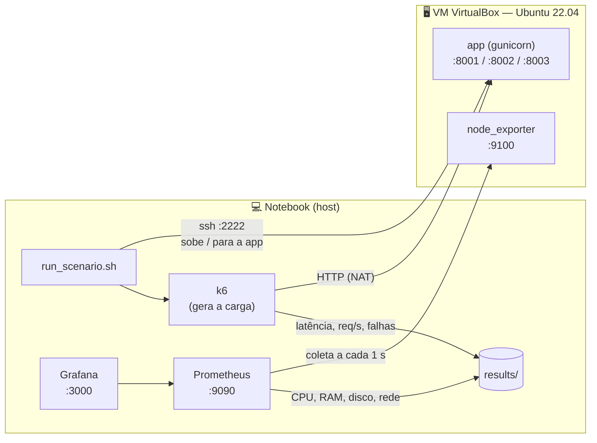

# Demanda, Provisionamento e Desempenho

Atividade 2 da disciplina **Provisionamento e Operações de Infraestrutura**.

Três aplicações backend, cada uma "pesada" em um recurso diferente (**CPU**, **memória** e **disco**), rodando numa VM do VirtualBox e testadas sob carga. Em cada experimento variamos duas coisas:

- **a demanda**: quantos usuários simultâneos o k6 simula;
- **o provisionamento**: quantos vCPUs e quanta RAM a VM tem.

A pergunta é: **quando o desempenho degrada, e mais recurso resolve?** Spoiler: depende de *qual* recurso a app usa.

---

## As três aplicações

| App | Porta | Gargalo | O que ela faz | O que esperamos ver |
|---|---|---|---|---|
| [**Cofre Digital**](apps/cofre_digital/README.md) | 8001 | 🔥 **CPU** | Primos por divisão, SHA-256 iterado e multiplicação de matrizes, tudo em Python puro | Melhora com **mais vCPUs**. RAM extra não muda nada. |
| [**Galeria de Filtros**](apps/galeria_filtros/README.md) | 8002 | 🧠 **Memória** | Gera imagens, guarda num cache LRU em RAM, aplica filtros e monta mosaicos | Melhora com **mais RAM** (cache maior, mais acertos). Com pouca RAM: swap e OOM. |
| [**Bolsa Fictícia**](apps/bolsa_ficticia/README.md) | 8003 | 💾 **Disco** | Corretora simulada: cada ordem vai para o SQLite e para um livro-caixa, com `fsync` | Muda **pouco** com vCPU ou RAM: o gargalo é o disco. |

Os gargalos são de propósito:
- O **cofre** evita numpy para ficar preso ao GIL: cada worker usa no máximo ~1 núcleo, então ele sobe um worker por vCPU (`WORKERS=auto`).
- A **galeria** dimensiona o cache como uma fração da RAM da VM.
- A **bolsa** grava com `synchronous=FULL` e faz `fsync` a cada ordem.

As três seguem o mesmo padrão (FastAPI + Gunicorn, camadas controller → service → repository), descrito em [`docs/CONTRACT.md`](docs/CONTRACT.md).

---

## Como o experimento funciona



- **A carga sai do notebook**, nunca de dentro da VM. Se o gerador de carga rodasse na VM, ele disputaria CPU e RAM com a app que está sendo medida.
- **As métricas da VM ficam fora dela.** Dentro da VM roda só o `node_exporter`, um processo de ~15 MB. Prometheus e Grafana rodam no notebook.

### Um cenário, passo a passo

A configuração da VM é **feita à mão** pela interface do VirtualBox. O script automatiza só a parte repetitiva:


Cada cenário leva **~40 min** sozinho. Os quatro cenários de provisionamento mudam **um recurso por vez**:

| Cenário | vCPU | RAM | Compara com o anterior |
|---|---:|---:|---|
| `1cpu-1gb` | 1 | 1 GB | ponto de partida |
| `1cpu-2gb` | 1 | 2 GB | só a RAM, que interessa para a galeria |
| `2cpu-2gb` | 2 | 2 GB | só a CPU, que interessa para o cofre |
| `4cpu-4gb` | 4 | 4 GB | cenário folgado |

| App | Níveis de demanda (usuários simultâneos) |
|---|---|
| cofre_digital | 1 · 4 · 8 · 16 · 32 |
| galeria_filtros | 2 · 5 · 10 · 20 · 40 |
| bolsa_ficticia | 5 · 20 · 50 · 100 · 200 |

---

## Começo rápido

### Rodar uma app e os testes

```bash
cd apps/cofre_digital
python3 -m venv .venv && .venv/bin/pip install -r requirements-dev.txt
WORKERS=2 ./run.sh                 # sobe em http://localhost:8001
curl localhost:8001/health
.venv/bin/pytest -q                # sobe um servidor de verdade numa porta livre e testa (sem mocks)
```

As três apps funcionam igual: troque a pasta e a porta.

### Rodar o experimento

O passo a passo completo, com todos os comandos, está em **[`docs/ROTEIRO_VM.md`](docs/ROTEIRO_VM.md)**. Em resumo:

```bash
# uma vez: criar a VM, redirecionar as portas (2222, 8001-8003, 9100), instalar
# node_exporter + venvs na VM e copiar a chave SSH (ver roteiro)

cd monitoring && docker compose up -d && cd ..     # Prometheus + Grafana

# para cada cenário: ajusta a VM no VirtualBox e roda
loadtest/run_scenario.sh 1cpu-1gb

# no fim: gráficos
python3 -m venv loadtest/.venv && loadtest/.venv/bin/pip install -r loadtest/requirements.txt
loadtest/.venv/bin/python loadtest/analyze.py
```

Abra o Grafana em <http://localhost:3000> para ver CPU, RAM e disco da VM ao vivo durante o teste.

### Testar tudo sem VM

Dá para rodar o fluxo inteiro só no notebook, útil para conferir se está tudo instalado:

```bash
docker run -d --name node-exporter --net=host --pid=host -v /:/host:ro,rslave \
    prom/node-exporter:v1.9.1 --path.rootfs=/host
VM_SSH="" VM_REPO="$PWD" DURACAO=15s RAMPA=3s PAUSA=3 loadtest/run_scenario.sh teste cofre_digital
rm -rf results/*/teste            # não commitar resultado de teste
```

---

## Resultados

Tudo o que o script gera vai para `results/<app>/<cenario>/` e é **versionado** (o trabalho exige):

| Arquivo | De onde vem | O que tem |
|---|---|---|
| `<nivel>.k6.json` | k6 | latência (média, p50, p95, p99), req/s, falhas, início/fim do teste |
| `<nivel>.app.json` | a própria app | galeria: acertos/despejos do cache · bolsa: tempo médio de `fsync` |
| `metricas_vm.csv` | Prometheus | 1 linha por segundo: CPU (user/system/iowait/steal), load, RAM, swap, disco, rede |

O `analyze.py` transforma isso em `results/_analysis/`:

- `resumo.csv`: uma linha por app × cenário × nível, com todas as médias;
- `<app>/<métrica>.png`: a métrica × usuários, uma linha por cenário. É o gráfico central do relatório;
- `<app>/visao_geral.png`: todas as métricas da app numa figura;
- `<app>/serie_<cenario>.png`: CPU, RAM e disco ao longo do teste, com uma faixa para cada nível de demanda.

**Como ler os gráficos:**
- **Degradação:** a vazão (req/s) para de subir enquanto os usuários aumentam, e a latência p95 dispara. Esse "joelho" é o limite daquele provisionamento.
- **Efeito do provisionamento:** compare a posição do joelho entre os cenários. Ele deve se mover com vCPU no cofre e com RAM na galeria, e ficar quase parado na bolsa.

---

## Estrutura do repositório

```
apps/
  cofre_digital/        CPU-bound      (FastAPI + Gunicorn, testes com servidor real)
  galeria_filtros/      memory-bound
  bolsa_ficticia/       IO-bound
loadtest/
  run_scenario.sh       roda um cenário: 3 apps × 5 níveis
  k6/                   scripts de carga (comum.js = rampa + resumo JSON)
  metricas_vm.py        confere a VM e exporta as métricas do Prometheus
  analyze.py            tabela e gráficos
monitoring/             docker compose com Prometheus + Grafana (dashboard pronto)
results/                dados brutos dos experimentos + _analysis/
docs/
  ROTEIRO_VM.md         passo a passo: VM, monitoramento, cenários, análise
  CONTRACT.md           convenções das apps, dos scripts e dos resultados
  atividade/            enunciado, roteiro do professor e template do relatório
```

## Ferramentas

FastAPI · Gunicorn/Uvicorn · SQLite · numpy · k6 · Prometheus · node_exporter · Grafana · pandas · matplotlib · VirtualBox
